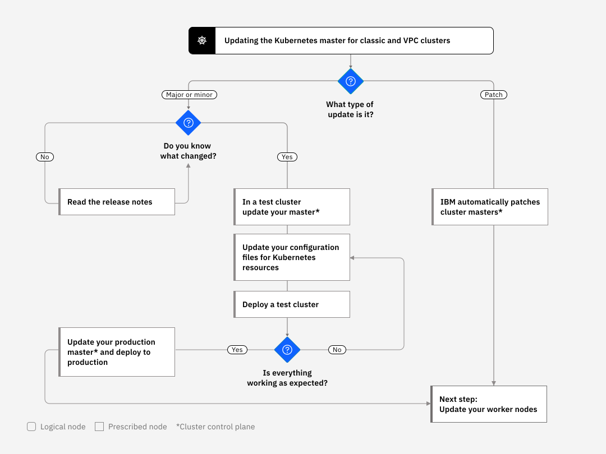

---

copyright:
  years: 2026, 2026
lastupdated: "2026-11-06"

keywords: openshift, {{site.data.keyword.openshiftlong_notm}}, update cluster master, upgrade master, master patch, api server

subcollection: openshift

content-type: howto

---

{{site.data.keyword.attribute-definition-list}}

# Updating the cluster master
{: #update-master}

Update the Kubernetes API server and associated master components to a new major, minor, or patch version. Update the master before you update your worker nodes.
{: shortdesc}

## How master updates work
{: #master-update-faq}

How do I know when to update the master?
:   You are notified in the console, announcements, and the CLI when updates are available. You can also periodically check the [supported versions page](/docs/openshift?topic=openshift-openshift_versions).

How many versions behind the latest can the master be?
:   You can update the API server only to the next version ahead of its current version (`n+1`).

Can my worker nodes run a later version than the master?
:   Your worker nodes can't run a later `major.minor` Kubernetes version than the master. Additionally, your worker nodes can only be one minor version behind the master version (`n-1`). First, [update your master](#master-steps) to the latest Kubernetes version. Then, update the worker nodes in your cluster by following the steps for [VPC](/docs/openshift?topic=openshift-update-workers-vpc) or [classic](/docs/openshift?topic=openshift-update-workers-classic) worker nodes.

Worker nodes can run later patch versions than the master, such as patch versions that are specific to worker nodes for security updates.

How are patch updates applied?
:   By default, patch updates for the master are applied automatically over the course of several days, so a master patch version might show up as available before it is applied to your master. The update automation also skips clusters that are in an unhealthy state or have operations currently in progress. Occasionally, IBM might disable automatic updates for a specific master fix pack, such as a patch that is only needed if a master is updated from one minor version to another. In any of these cases, you can check the [{{site.data.keyword.openshiftshort}} version information](/docs/openshift?topic=openshift-openshift_versions) for any potential impact and choose to safely use the `ibmcloud oc cluster master update` [command](/docs/openshift?topic=openshift-kubernetes-service-cli#cluster-master-update-cli) yourself without waiting for the update automation to apply.

Unlike the master, you must update your workers for each patch version.

What happens during the master update?
:   Your master is highly available with three replica master pods. The master pods have a rolling update, during which only one pod is unavailable at a time. Two instances are up and running so that you can access and change the cluster during the update. Your worker nodes, apps, and resources continue to run.

Can I roll back the update?
:   No, you can't roll back a cluster to a previous version after the update process takes place. Be sure to use a test cluster and follow the instructions to address potential issues before you update your production master.

What process can I follow to update the master?
:   The following diagram shows the process that you can take to update your master.

{: caption="Updating Kubernetes master process diagram" caption-side="bottom"}

## Steps to update the cluster master
{: #master-steps}

Before you update the master, complete the checks in [Preparing to update your cluster](/docs/openshift?topic=openshift-update-prepare).

To update the {{site.data.keyword.redhat_openshift_notm}} master _major_ or _minor_ version:

1. Update your API server and associated master components by using the [{{site.data.keyword.cloud_notm}} console](https://cloud.ibm.com/login){: external} or running the CLI `ibmcloud oc cluster master update` [command](/docs/openshift?topic=openshift-kubernetes-service-cli#cluster-master-update-cli).
2. Wait for the update to complete, which typically takes 30 - 60 minutes, then confirm that it is complete. Review the API server version on the {{site.data.keyword.cloud_notm}} clusters dashboard or run `ibmcloud oc cluster ls`. While the update runs, the cluster shows the [**Updating**](/docs/openshift?topic=openshift-cluster-states-reference#cluster-state-updating) state. If the update fails, the cluster shows the [**Update failed**](/docs/openshift?topic=openshift-cluster-states-reference#cluster-state-failed) state. During the update, you can still access and change the cluster, but you can't start concurrent master operations, such as enabling API server auditing. If the cluster stays in the **Update failed** state for more than 1 day, [open a support case](/docs/openshift?topic=openshift-get-help).
3. Install the version of the [`oc cli`](/docs/openshift?topic=openshift-cli-install) that matches the API server version that runs in the master. Kubernetes does not support `oc` client versions that are two or more versions apart from the server version (n +/- 2). To refresh your local configuration, run `ibmcloud oc cluster config -c CLUSTER_NAME_OR_ID`, then verify with `oc version --client`.

## Next steps
{: #update-master-next}

When the master update is complete, update your worker nodes. The method depends on your infrastructure type:

* [Updating VPC worker nodes](/docs/openshift?topic=openshift-update-workers-vpc) uses `worker reload` for VPC bare metal workers, and `worker replace --update` for VPC VSI workers. The ConfigMap rolling update procedure is not yet supported for VPC worker nodes.
* [Updating classic worker nodes](/docs/openshift?topic=openshift-update-workers-classic) uses a rolling update that is controlled by a ConfigMap and the `worker update` command.

## Related links
{: #update-master-related}

* [Updating clusters, worker nodes, and cluster components](/docs/openshift?topic=openshift-update)
* [Cluster states and statuses](/docs/openshift?topic=openshift-cluster-states-reference)
* [Reviewing master health](/docs/openshift?topic=openshift-debug_master)
